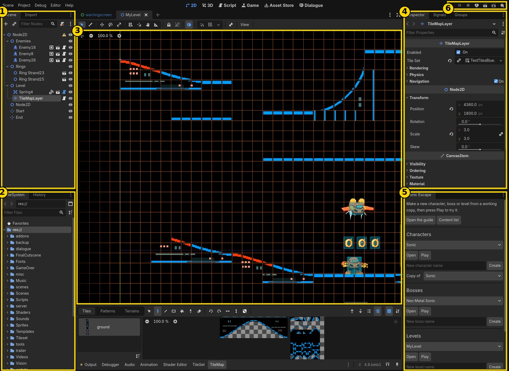
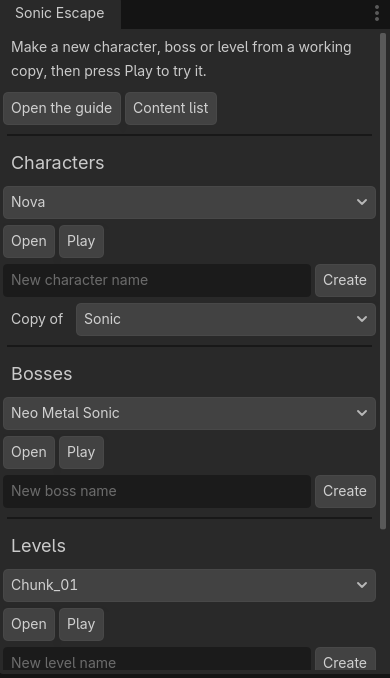
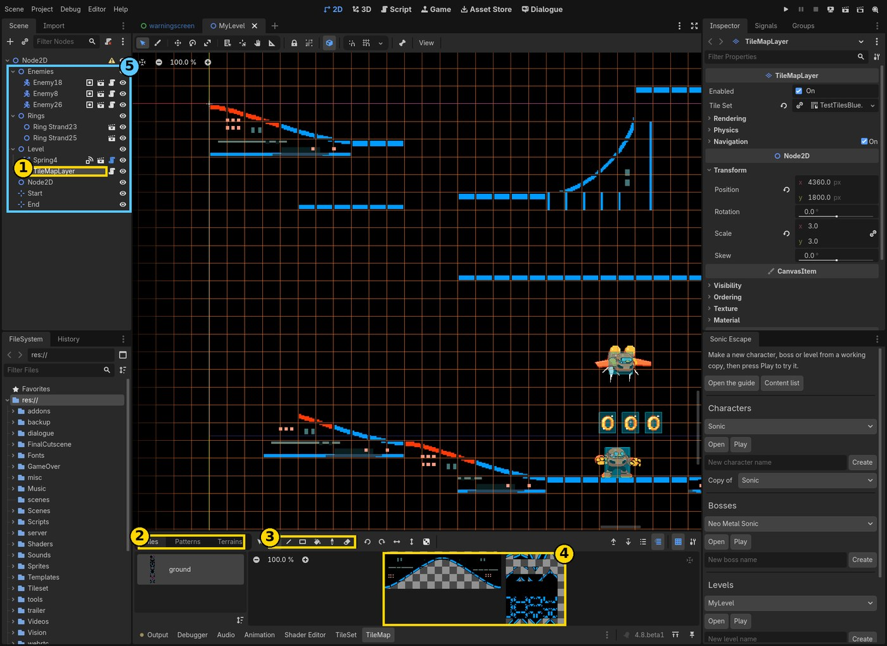
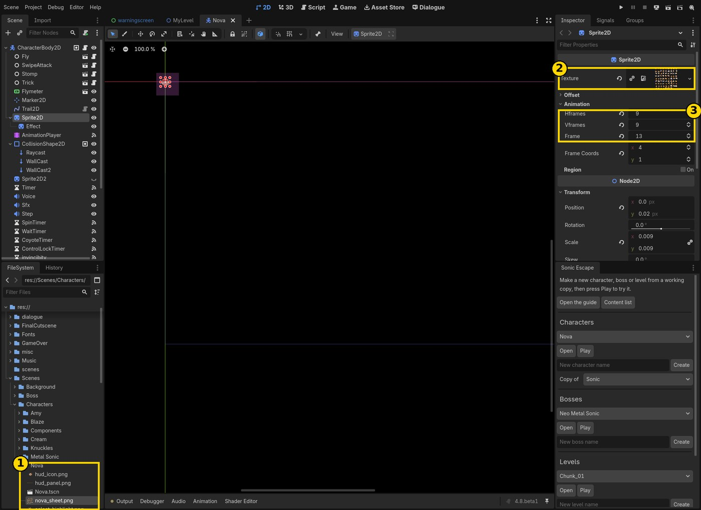
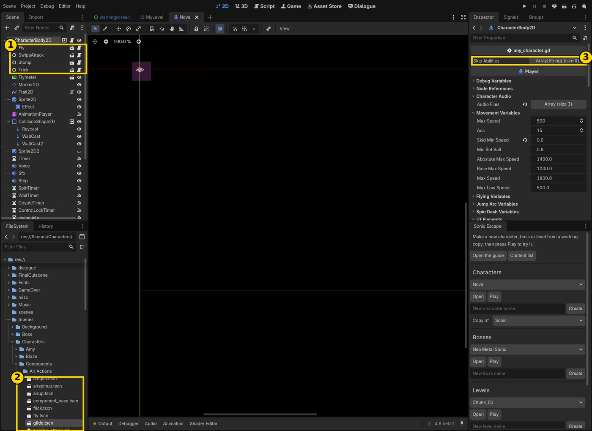
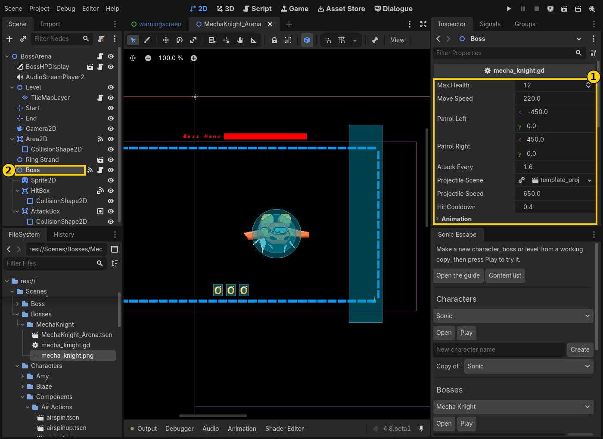
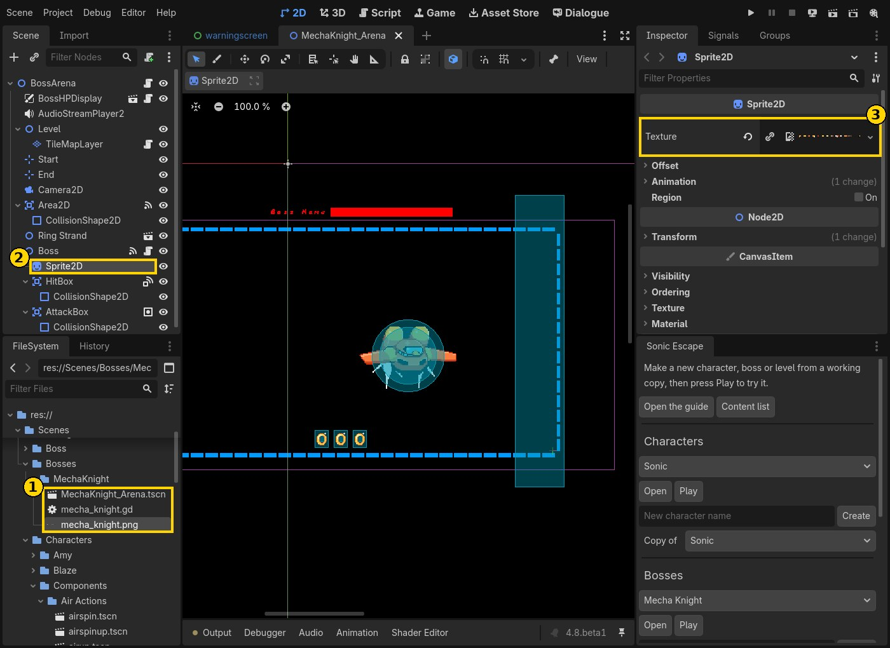
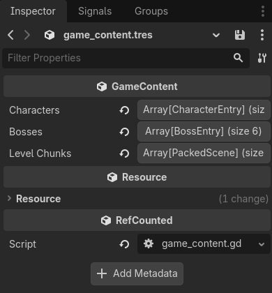

# Making things for Sonic Escape

This guide is for anyone who wants to add a level, a character or a boss to
Sonic Escape, including people who have never opened Godot before. You don't
need to write code for any of it. The game comes with a **Sonic Escape panel**
inside the editor that makes a working copy for you, adds it to the game, and
plays it with one click.

- [1. Get set up](#1-get-set-up)
- [2. A quick tour of the editor](#2-a-quick-tour-of-the-editor)
- [3. Make a level](#3-make-a-level)
- [4. Make a character](#4-make-a-character)
- [5. Make a boss](#5-make-a-boss)
- [6. The content list](#6-the-content-list)
- [7. Sharing what you made](#7-sharing-what-you-made)
- [8. When something goes wrong](#8-when-something-goes-wrong)

---

## 1. Get set up

1. **Download Godot 4.8 beta 1.** Use this exact version, the standard one
   (not ".NET"): <https://godotengine.org/download/archive/>. Godot doesn't
   install anything; unzip it and run the program inside.
2. **Download the project** and unzip it somewhere easy to find, like your
   Documents folder. (On GitHub: the green **Code** button, then **Download ZIP**.)
3. **Open it.** In Godot's Project Manager, press **Import**, pick the
   `project.godot` file inside the folder, then **Import & Edit**.

The first time takes a few minutes while Godot prepares all the art and sound.
After that it opens in seconds.

To play the whole game at any time, press **F5** (or the ▶ button in the top
right corner). **F8** stops it.

## 2. A quick tour of the editor



1. **Scene**: everything in the thing you have open, as a list. Click
   something here to select it.
2. **FileSystem**: all the project's files: pictures, sounds, levels,
   characters. You can drag things from here into a level.
3. **The view**: your level, character or boss. Scroll the mouse wheel to zoom,
   hold the middle mouse button (or Space + left mouse) to move around.
4. **Inspector**: the settings of whatever you selected. This is where you
   change numbers, colours and pictures.
5. **Sonic Escape panel**: makes new levels, characters and bosses, and plays
   them.
6. **Play buttons**: ▶ plays the whole game from the start.



The panel has a part for each kind of thing. Each part has:

- a list of everything of that kind that's already in the game,
- **Open**: opens the one picked in the list,
- **Play**: starts the game straight in it (a level, a boss fight, or a
  floor played as that character). Use **Play as** at the bottom to choose who
  you play as,
- a name box and **Create**: makes a new one.

Save your work with **Ctrl+S** (**Cmd+S** on a Mac). **Play** saves for you.

## 3. Make a level

The game builds each floor by joining short level pieces ("chunks") end to end
in a random order. You make one chunk, and from then on it can turn up in any
run.

1. In the panel under **Levels**, type a name (for example "Sky Bridge"). Leave
   **Copy of** on *Template*, or pick an existing chunk to start from a copy of
   it.
2. Press **Create**. Your level opens. It's in `Scenes/LevelChunks/Custom/`.
3. Press **Play** to run straight into it.



**Draw the ground:**

1. In the Scene list, click **TileMapLayer** (inside *Level*).
2. The **Tiles** tab opens at the bottom.
3. Pick the pencil to draw, the rectangle to fill an area, or the eraser.
4. Click a tile in the tile sheet, then paint in the view.

**Add things to run into** (5): drag them from the FileSystem into the view.

| What | Where in FileSystem |
| --- | --- |
| Rings | `Scenes/Obstacles/Rings/ring_strand.tscn` |
| Springs | `Scenes/Obstacles/Spring/Spring.tscn` |
| Enemies | `Scenes/Obstacles/Enemies/enemy.tscn` and `enemyfly.tscn` |
| Grind rails | `Scenes/Obstacles/Rail/Rail.tscn` |
| Loops | `Scenes/Obstacles/Loop/loop.tscn` |

Drop rings under *Rings* and enemies under *Enemies* in the Scene list to keep
things tidy; it doesn't change how they work.

**Start and End:** your chunk joins the previous one at **Start** and the next
one at **End**. Keep Start at the left edge of your ground and End at the right
edge, at the height the ground is at. Select one and drag it in the view to
move it.

## 4. Make a character

1. In the panel under **Characters**, pick who to copy in **Copy of**. Your
   character starts out moving exactly like them (Tails flies, Knuckles glides,
   Sonic boosts and homing-attacks...).
2. Type a name and press **Create**. The character opens, gets a slot on the
   character select screen, and is in the online lobby's list.
3. Press **Play** to run a floor as them.



**Change how they look.** Your character has its own folder (1) in
`Scenes/Characters/` with copies of the pictures, so you can paint over them in
any drawing program without touching the original character:

| File | What it is |
| --- | --- |
| `<name>_sheet.png` | Every animation frame, in a grid |
| `hud_icon.png`, `hud_panel.png` | The portrait in the top-left corner during a run |
| `select_icon.png`, `select_icon_active.png`, `select_highlight.png` | The character select screen pictures |

Keep the sheet the same size, with each frame in the same place in the grid:
the animations pick frames by their position. In the Inspector, **Texture** (2)
shows which picture is used, and **Hframes** and **Vframes** (3) say how many
frames across and down the sheet has. After you save a picture, Godot updates
it by itself when you come back to the editor.



**Change what they can do.** Each ability is a node under the character (1):
*Fly*, *SwipeAttack*, *Stomp* and so on.

- **To add one**, drag it from `Scenes/Characters/Components/` (2) onto the
  character's top node in the Scene list. *Air Actions* happen in the air,
  *Ground Actions* on the ground, *Wall Mechanics* against walls.
- **To remove one**, select it and press **Delete**.
- **To switch one off** without deleting it, select the top node and add its
  name to **Skip Abilities** (3) in the Inspector.

**Change how they move.** Select the character's top node. The Inspector shows
groups like *Movement Variables* (top speed, acceleration), *Jump Arc
Variables* (jump height, how floaty it feels) and *Flying Variables*. Change a
number, press **Play**, and feel the difference.

## 5. Make a boss

1. In the panel under **Bosses**, type a name and press **Create**.
2. The boss arena opens: the room, the boss, and its health bar. It's in
   `Scenes/Bosses/<name>/`.
3. Press **Play** to fight it.

The new boss already works: it starts out as a giant Flapper (the flying
enemy) that floats from side to side, shoots energy balls at you, takes
hits from your attacks and from thrown Mikus, has a health bar, and dies. From
then on it's one of the bosses a run can pick.



**Change how it fights.** Click **Boss** in the Scene list (2). The Inspector
(1) shows:

| Setting | What it does |
| --- | --- |
| Max Health | How many hits it takes. A thrown Miku counts as 2. |
| Move Speed | How fast it floats between its two points |
| Patrol Left / Patrol Right | The two points, measured from where it starts |
| Attack Every | Seconds between shots |
| Projectile Scene / Projectile Speed | What it shoots, and how fast |
| Hit Cooldown | How long it can't be hurt after a hit |
| Animation: Idle / Attack / Hurt Frames | Which frames of the sprite sheet each animation uses (first, last) |
| Animation: Frames Per Second | How fast the animations play |
| Animation: Faces Left | Tick it if your sheet's frames face left |

To move the boss or the room around, select them and drag them in the view.



**Change how it looks.** `<name>.png` in the boss's folder (1) is the boss's
own copy of the Flapper sprite sheet: 14 frames side by side (idle 0–6, hurt
7–10, attack 11–13). Paint over it, or use a different picture: select
**Sprite2D** (2), drag your picture from the FileSystem onto **Texture** (3), set
**Hframes** to how many frames it has (1 for a single picture), and set the
frame numbers in Boss's **Animation** settings. Its shots use Goku Black's
energy ball; to change them, open `Templates/Boss/template_projectile.tscn` and
give its **Sprite2D** a different texture.

**The health bar's name:** select **BossHPDisplay** and change **Boss Name**.

### Going further: new attacks (a little code)

The boss's behaviour is in `<name>.gd` in its folder (double-click it to open
it). The attack is the part that starts with `func _attack()`. For example, to
fire three shots in a fan instead of one, replace that part with:

```gdscript
func _attack() -> void:
	var player := _find_player()
	if projectile_scene == null or player == null:
		return
	for angle in [-0.3, 0.0, 0.3]:
		var shot = projectile_scene.instantiate()
		shot.global_position = global_position
		shot.velocity = global_position.direction_to(player.global_position).rotated(angle) * projectile_speed
		get_parent().add_child(shot)
```

The lines starting with a tab must keep their tab. The bigger bosses in
`Scripts/Boss/` are good to read for more ideas.

## 6. The content list

Everything the game picks from is listed in one file: `game_content.tres`. The
panel adds your things to it for you; press **Content list** in the panel to
see it in the Inspector.



- **Characters**: in the order they appear on the character select screen.
- **Bosses**: every 4th floor is a boss fight, picked from this list. Untick
  **Enabled** on a boss to keep it out of runs while you work on it (you can
  still press Play on it).
- **Level Chunks**: the pieces floors are built from.

To take something out of the game, press the trash-can button next to its
entry. Its files stay where they are. To put a level back, press **Add
Element** under *Level Chunks* and drag its scene onto the new empty slot.

## 7. Sharing what you made

Everything you made lives in its own folder, plus your entries in
`game_content.tres`:

- a level: `Scenes/LevelChunks/Custom/<name>.tscn`
- a character: the folder `Scenes/Characters/<name>/`
- a boss: the folder `Scenes/Bosses/<name>/`

To send it to someone, zip those up together with `game_content.tres`. To get
it into the official game, ask the team, or open a pull request on GitHub if
you know how.

To play online together, everyone needs the same version of the game,
including the same custom characters and bosses.

## 8. When something goes wrong

- **Errors show up in red** in the **Output** tab at the bottom of the editor.
  Clicking one often jumps to the line it's about.
- **Changed a setting and want the original back?** Click the ↺ arrow next to
  it in the Inspector.
- **Broke something and want to undo?** **Ctrl+Z** undoes changes in the
  editor, one step at a time.
- **My level doesn't connect properly:** check that **Start** and **End** sit
  on the ground at its left and right edges.
- **My character doesn't show up on the character select screen:** check that
  it's in the content list's **Characters**, with its **Scene** filled in.
- **I pressed Play and a different floor came up:** press Play in the panel
  again. A level or boss started from the panel plays once; the next floor is
  a normal one.
